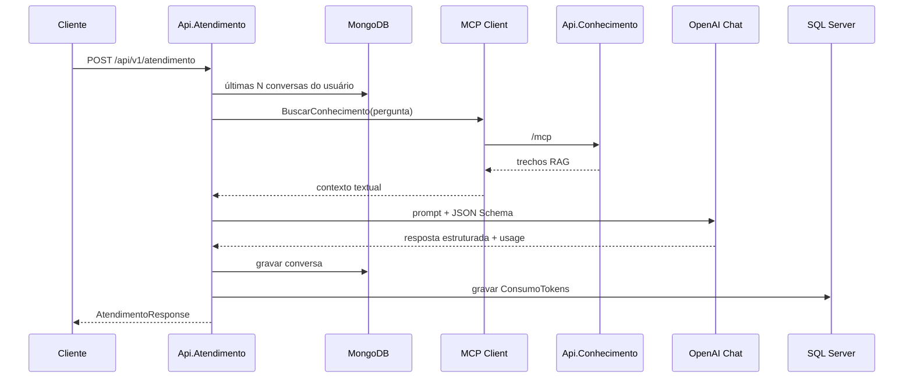

# Atendimento tributário e contábil

Documentação do fluxo implementado na **Api.Atendimento** (`src/Api.Atendimento`), orquestradora de perguntas sobre temas tributários e contábeis.

## Fluxo

1. O cliente envia **`POST /api/v1/atendimento`** com JSON `{ "usuario", "pergunta" }` (`AtendimentoController`).
2. O serviço **`OpenAiAtendimentoService`** executa a orquestração:
   - Recupera histórico conversacional do usuário no MongoDB.
   - Obtém contexto RAG via **MCP Client** (`ConhecimentoMcpClient`), chamando a tool **`BuscarConhecimento`** na Api.Conhecimento.
   - Monta o prompt com usuário, histórico, contexto e pergunta (`PromptAtendimento`).
   - Chama **OpenAI Chat** com **Structured Output** (JSON Schema: `resposta`, `categoria`, `fontes`). Se a OpenAI falhar, aciona **fallback Gemini** (`gemini-3.5-flash-lite`) com o mesmo schema JSON.
   - Persiste a conversa no MongoDB e o consumo de tokens no SQL Server.
3. A API responde com **`AtendimentoResponse`**: texto da resposta, categoria, fontes, modelo, flag de fallback, tokens e custo estimado.

Endpoints auxiliares para validar integração MCP (sem passar pelo LLM de atendimento):

- `GET /health`
- `GET /conhecimento/ferramentas` — lista tools expostas pelo servidor MCP
- `POST /conhecimento/buscar` — invoca busca de conhecimento diretamente

Porta HTTP padrão: **5100**. Exemplos em `src/Api.Atendimento/Api.Atendimento.http`.



**Pré-requisito:** Api.Conhecimento em execução (MCP em `http://localhost:5200/mcp` por padrão) antes de atender perguntas que dependem de RAG.

## Controle de consumo de tokens

Após cada chamada ao modelo de chat, o serviço lê `completion.Usage` (tokens de entrada e saída) e:

1. Calcula custos parciais e total com **`CalculadoraCustoTokens`**, usando preços configuráveis por milhão de tokens (`SqlCustos:PrecoEntradaPorMilhao`, `SqlCustos:PrecoSaidaPorMilhao`).
2. Grava um registro em **`dbo.ConsumoTokens`** no SQL Server via **`SqlConsumoTokensRepository`**, incluindo agente, modelo, usuário, data/hora, quantidades, custos e **`IdConversa`** (referência ao documento Mongo da interação).
3. Expõe na resposta REST: `tokensEntrada`, `tokensSaida`, `custoEstimado`.

Configuração padrão em `appsettings.json` → seção **`SqlCustos`** (connection string para `bd-custos-ia`).

## Memória conversacional

A memória é **por usuário** (campo `usuario` da requisição), não global:

- **Leitura:** `MongoConversacaoHistoricoRepository.ListarUltimasDoUsuarioAsync` busca as **`QuantidadeHistorico`** conversas mais recentes (padrão **3**), ordenadas do mais antigo ao mais recente para compor o bloco `HISTORICO` no prompt.
- **Escrita:** após gerar a resposta, grava **`ConversacaoHistorico`** na collection **`conversas`** (banco `bd-historico-atendimentos`), com pergunta, resposta estruturada, texto da resposta, agente e timestamp UTC.

Regras de uso no prompt (`PromptAtendimento`):

- O histórico serve apenas para **continuidade** (referências, tema anterior).
- **Não** deve ser tratado como fonte normativa; fatos tributários/contábeis vêm somente do **CONTEXTO** RAG.

Configuração: seção **`MongoHistorico`** em `appsettings.json`.

## Resposta

O LLM deve obedecer instruções de domínio (somente tributário/contábil), uso exclusivo do contexto MCP para fatos, recusa educada fora do escopo e categorias:

| Campo | Valores / conteúdo |
|--------|---------------------|
| `resposta` | Texto em português do Brasil |
| `categoria` | `tributaria`, `contabil` ou `fora_do_escopo` |
| `fontes` | Documentos citáveis quando o contexto permitir; lista vazia se insuficiente |
| `modelo` | `OpenAI:ChatModel` (padrão `gpt-4o-mini`) ou `Gemini:ChatModel` (`gemini-3.5-flash-lite`) conforme quem gerou |
| `fallback` | `false` quando OpenAI responde; `true` quando a resposta veio do Gemini (contingência) |
| `encaminharSuporteHumano` | `true` quando o LLM identifica pedido explícito de humano ou insatisfação clara (Etapa 8) |
| `idOutboxEncaminhamento` | Id numérico em `dbo.OutboxMessage` quando o encaminhamento foi gravado; `null` caso contrário |

A saída JSON do LLM inclui também `encaminharSuporteHumano` e `descricaoEncaminhamento` (schema em **`RespostaAtendimentoJsonSchema`**). A saída é forçada por **`OpenAiRespostaGerador`** (OpenAI strict JSON Schema) e **`GeminiFallbackGerador`** (`ResponseJsonSchema` + `application/json`).

### Fallback Gemini (Etapa 7)

- OpenAI é sempre tentada primeiro (`IOpenAiRespostaGerador`).
- Qualquer falha não cancelada na OpenAI dispara **`IGeminiFallbackGerador`** com o mesmo prompt.
- Chave Gemini: `Gemini:ApiKey`, `GEMINI_API_KEY` ou `GOOGLE_API_KEY` (validada só no fallback).
- Modelo padrão: `gemini-3.5-flash-lite` (`Gemini:ChatModel`).
- Se ambos falharem, a API retorna **502** com `ProblemDetails`; em Development, `detail` e `innerException` explicam a causa (chave Gemini ausente, modelo inválido, etc.).

**Testar fallback:** invalide só a chave OpenAI (User Secrets) e confirme que a chave Gemini está configurada nos dois formatos acima antes de chamar o atendimento.

### Suporte humano e outbox (Etapa 8)

Quando o modelo define `encaminharSuporteHumano: true`, o serviço **`EncaminhamentoSuporteHumanoService`** invoca a função Semantic Kernel **`SuporteHumano.encaminhar_atendimento_humano`** (`EncaminhamentoSuportePlugin`), que grava **`dbo.OutboxMessage`** no SQL Server (`bd-custos-ia`, mesma connection string de custos).

Critérios no **`PromptAtendimento`**:

1. Usuário pede explicitamente atendimento humano / operador / especialista.
2. Insatisfação clara com o atendimento automatizado.

Colunas da outbox:

| Coluna | Descrição |
|--------|-----------|
| `Id` | `BIGINT` identity (sequencial) |
| `DataHoraGravacao` | UTC no insert |
| `Transmitido` | `false` por padrão |
| `DataHoraTransmissao` | `NULL` por padrão |
| `NomeFila` | `NULL` por padrão |
| `Usuario` | Campo `usuario` da requisição |
| `Descricao` | Resumo gerado pelo LLM (`descricaoEncaminhamento`) |

Scripts de criação: [`01-create-database.sql`](../docker/sqlserver/init/01-create-database.sql) (inclui `OutboxMessage`) e [`02-outbox-message.sql`](../docker/sqlserver/init/02-outbox-message.sql). O `docker-compose` aplica os dois na subida do SQL. Se aparecer **`Invalid object name 'dbo.OutboxMessage'`**, o volume foi criado antes da outbox — rode no container:

`docker exec custos-infis-sqlserver /opt/mssql-tools18/bin/sqlcmd -S localhost -U sa -P "Coti@2026" -C -i /init/02-outbox-message.sql`

**Validação manual (encaminhamento):**

```json
POST /api/v1/atendimento
{
  "usuario": "Maria",
  "pergunta": "Quero falar com um atendente humano sobre IBS."
}
```

Resposta esperada: `encaminharSuporteHumano: true`, `idOutboxEncaminhamento` preenchido. Confirme no SQL: `SELECT TOP 5 * FROM dbo.OutboxMessage ORDER BY Id DESC`.

### Relay RabbitMQ, worker e e-mail (Etapa 9)

Após a gravação na outbox, o **`OutboxRelayBackgroundService`** (na Api.Atendimento) publica pendências na fila RabbitMQ **`atendimentos`**. O **`Worker.AtendimentoSuporte`** consome a fila, persiste **`InboxMessage`** e envia e-mail HTML via **Mailhog**.

Detalhes operacionais, portas e teste ponta a ponta: [`mensageria-suporte.md`](mensageria-suporte.md).

## Execução e validação

### Pré-requisitos

- .NET 8 SDK
- Docker Compose (MongoDB, SQL Server, Postgres para RAG na Api.Conhecimento)
- Chave OpenAI: `appsettings.Local.json` (copiar de `appsettings.Local.example.json`), User Secrets, `OpenAI:ApiKey` ou `OPENAI_API_KEY` (Api.Atendimento e Api.Conhecimento)
- Chave Gemini (fallback): `appsettings.Local.json`, User Secrets (`Gemini:ApiKey` e/ou `GEMINI_API_KEY`), env `GEMINI_API_KEY` / `GOOGLE_API_KEY`; gestão via `GET/PUT /api/v1/config/gemini` (Development)

### Subir infraestrutura e APIs

```powershell
docker compose up -d
dotnet user-secrets set "OpenAI:ApiKey" "sua-chave" --project src/Api.Conhecimento
dotnet user-secrets set "OpenAI:ApiKey" "sua-chave" --project src/Api.Atendimento
dotnet run --project src/Api.Conhecimento --launch-profile http
dotnet run --project src/Api.Atendimento --launch-profile http
```

### Checklist de validação manual

| Passo | Como validar | Resultado esperado |
|-------|----------------|-------------------|
| Health | `GET http://localhost:5100/health` | Status healthy |
| MCP | `GET /conhecimento/ferramentas` | Tool `BuscarConhecimento` listada |
| RAG via MCP | `POST /conhecimento/buscar` com `{ "consulta": "..." }` | Trechos ou mensagem de vazio |
| Atendimento | `POST /api/v1/atendimento` com usuário e pergunta tributária/contábil | JSON com `resposta`, `categoria`, `fontes`, tokens, custo e flags de encaminhamento |
| Outbox | Após pergunta pedindo humano | Linha em `dbo.OutboxMessage` com `Transmitido = 0` |
| Histórico | Repetir atendimento com mesmo `usuario` | Respostas coerentes com continuidade (Mongo) |
| Custos | Consultar `ConsumoTokens` no SQL Server após chamada | Nova linha com tokens e `IdConversa` |

Swagger: http://localhost:5100/swagger

Validação automatizada existente no repositório: testes de similaridade e extração de termos RAG na Api.Conhecimento. Testes de integração end-to-end do atendimento ainda não estão no escopo implementado (ver `docs/checklist.md`).

## Troubleshooting — “dados insuficientes na base”

A mensagem é produzida pelo **LLM** quando o prompt (`PromptAtendimento`) indica que o **CONTEXTO** não sustenta a resposta. Não é um erro HTTP fixo da API.

1. **Mesma consulta:** copie a `pergunta` do atendimento e envie em `POST /conhecimento/buscar` como `consulta`. O atendimento usa essa mesma string na tool MCP `BuscarConhecimento`.
2. **Compare trechos:** se a busca direta traz o tema (ex.: IBS) mas o atendimento recusa, o contexto pode ser **parcial** — o prompt foi ajustado para preferir resposta parcial com citação em vez de negar o termo.
3. **Pergunta longa vs. sigla:** a busca RAG gera embedding da pergunta inteira **e** de siglas maiúsculas (`IBS`, `CBS`, etc.), com boost quando o chunk contém o termo literal. Confira logs da Api.Conhecimento (`Busca RAG: ... top K`).
4. **Top-K:** padrão `Rag:QuantidadeResultados` = 8. Aumente se o PDF for grande e a resposta depender de trechos distantes.
5. **PDF ingerido:** confirme chunks vigentes no Postgres (`data_validade` nula ou futura). Ver `docs/ingest.md`.
